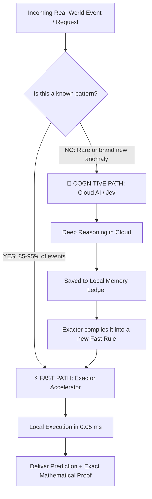

# ⚡ Exactor Accelerator: The Reflex Engine for AI

> **An easy-to-understand visual guide explaining how Exactor Accelerator brings instant, explainable, and zero-cost decisions to modern Artificial Intelligence.**

---

## 💡 The Human Reflex Metaphor (Learning to Drive)

```
                    BEFORE (Without Exactor)                          AFTER (With Exactor)
                   ---------------------------                     -------------------------
   Situation:     First day learning to drive                     6 months of daily practice
   Cognition:     Deep conscious calculation                      Automatic muscle memory
                  "When do I clutch? Am I braking?"               Feet and hands move instantly
   Speed:         Slow & exhausting (System 2)                    Lightning fast reflex (System 1)
   In AI Terms:   Cloud AI (Jev / LLMs)                           Local Reflex Engine (Exactor)
```

---

## 📊 Key Highlights at a Glance

| Metric | Cloud AI Alone | With Exactor Accelerator | Impact |
| :--- | :--- | :--- | :--- |
| **Decision Speed** | ~500 ms – 1,200 ms | **0.05 ms** (microseconds) | **Up to 24,000x Faster** |
| **Cost per Routine Query** | Continuous token fees ($$$) | **$0.00** | **Massive Cloud Bill Savings** |
| **Audit & Transparency** | Statistical "Black Box" guess | **100% Deterministic Rule Proof** | **Full Legal & Regulatory Safety** |
| **Internet Outage** | System goes down completely | **Keeps answering autonomously** | **Zero Downtime Resilience** |

---

## 🔄 How It Works: The 4-Step Cycle



1. **Step 1: Zero-Data Cold Start**  
   You don't need years of pre-labeled historical data. New ambiguous questions simply go to the cloud brain (Jev).
2. **Step 2: Silent Ledger Recording**  
   Exactor silently records every smart response into a super-fast, local memory database.
3. **Step 3: Distillation into Crystal-Clear Logic**  
   Exactor discovers recurring patterns and simplifies them into exact mathematical rules (`IF ... AND ... THEN`).
4. **Step 4: Instant Reflex Active**  
   From that moment on, identical and similar requests are answered directly on your server in **0.05 milliseconds** for **$0.00**.

---

## 🔍 The Superpower: Dual Output (Decision + Proof)

Most Artificial Intelligence acts like an opaque black box:

* ❌ **Standard Deep AI (Black Box):**  
  > *"We blocked this credit card transaction because our 500-layer neural network calculated an 88.2% fraud risk probability. We cannot tell you specifically which parameter caused it."*  
  *(Fails strict regulatory audits under GDPR, HIPAA, and banking compliance)*

* ✅ **Exactor Accelerator (Complete Causal Proof):**  
  > *"We blocked this credit card transaction because rule #14 fired: `(New_Device = True AND Country_Mismatch = True AND Transfer > $5,000)`."*  
  *(100% auditable, crystal clear to customers, regulators, and judges)*

---

## 💼 Why Business Leaders Care

1. **Slashes AI Cloud Bills**: Cuts up to 90%+ of repetitive token usage by resolving routine decisions on-premise.
2. **Eliminates Hallucinations**: Fast-path answers are grounded in strict boolean logic, making false outputs mathematically impossible.
3. **Continuous Autonomous Learning**: Learns in real time while your service runs without needing costly retraining cycles.
4. **Offline Resilience**: Even if external cloud APIs or internet cables go offline, your core business decisions keep operating.
